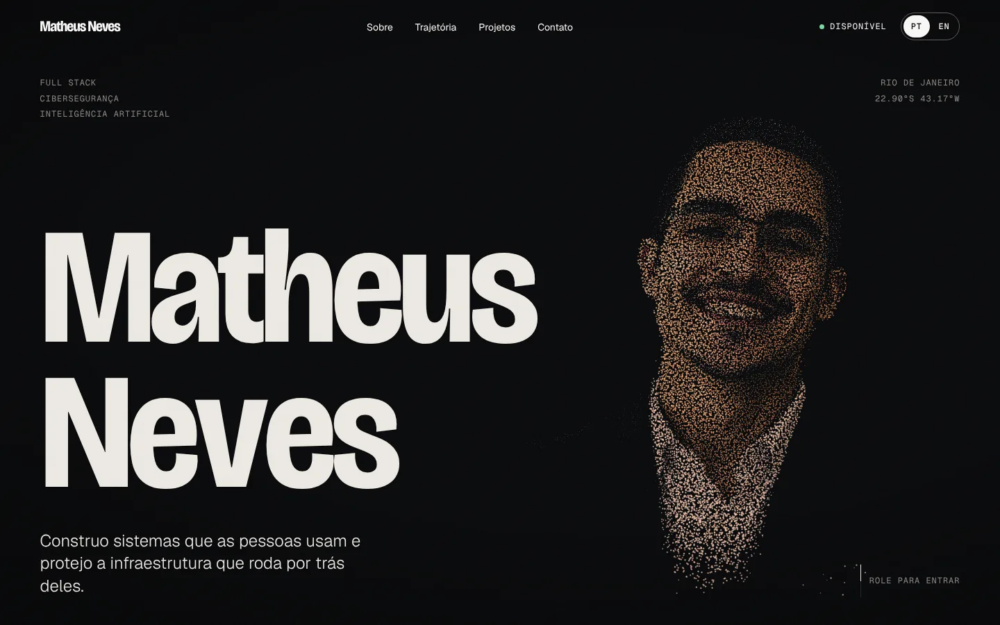

# Portfólio · Matheus Neves

Site pessoal de Matheus Neves, desenvolvedor full stack com foco em cibersegurança e IA.

👉 **[www.matheusnsp.com.br](https://www.matheusnsp.com.br)**



---

## O que tem no site

* **Retrato em partículas (WebGL):** a foto vira milhares de pontos que reagem ao mouse e se espalham em uma galáxia ao rolar a página
* **Rolagem suave e animações por cena:** texto que acende palavra por palavra, contadores, linhas que se desenham
* **Trajetória em capítulos:** Canberra → Robot De Niro → Cruz Vermelha → próximo capítulo
* **7 projetos com estudo de caso:** cada projeto abre em tela cheia com contexto, o que foi feito, resultado, tecnologias e links (navegação por setas e teclado)
* **PT / EN:** todo o conteúdo, o título da aba e o currículo trocam de idioma; a escolha fica salva no navegador
* **Pensado para qualquer tela:** o retrato se ajusta do celular à tela ultralarga
* **Instalável como app:** ícones e `site.webmanifest` para adicionar à tela inicial
* **Acessível:** respeita `prefers-reduced-motion` (sem animações pesadas) e funciona por teclado

## Tecnologias

* **Vite** para desenvolvimento e build
* **Three.js** para o retrato em partículas
* **GSAP + ScrollTrigger** para as animações
* **Lenis** para a rolagem suave
* HTML, CSS e JavaScript, sem framework
* Hospedagem na **Vercel**

## Rodar localmente

```bash
git clone https://github.com/matheusnsp/Portfolio.git
cd Portfolio
npm install
npm run dev
```

Abra `http://localhost:5173`.

Para gerar a versão de produção: `npm run build` (a saída fica em `dist/`).

## Publicação

A Vercel publica sozinha a cada push na branch `main`. Não é preciso rodar nenhum comando de deploy.

## Onde editar

| O quê | Onde |
| --- | --- |
| Textos em PT/EN (menu, sobre, números, contato) | objeto `T` em `src/site/main.js` |
| Capítulos da trajetória | `CHAPTERS` em `src/site/main.js` |
| Projetos e estudos de caso | `PROJECTS` em `src/site/main.js` |
| Habilidades (seção Arsenal) | `KIT` em `src/site/main.js` |
| Estrutura da página | `index.html` |
| Estilos | `src/site/style.css` |
| Imagens dos projetos e retrato | `public/img/` |
| Currículos e relatório | `public/cv-matheus-neves.pdf`, `public/resume-matheus-neves.pdf`, `public/A3_Report.pdf` |
| Logo, favicon e ícones de app | `public/logo.svg`, `public/icons/`, `public/site.webmanifest` |

**Retrato:** `public/img/retrato.webp` é a foto já recortada, sem fundo e com a base do terno esmaecida. Para trocar a foto, gere uma imagem no mesmo formato (PNG/WebP com transparência, rosto no terço de cima).

## Estrutura

```
index.html            página (conteúdo, metatags e ícones)
src/site/main.js      retrato WebGL, animações, PT/EN, projetos
src/site/style.css    estilos
public/img/           retrato, prints dos projetos e imagem de compartilhamento
public/icons/         favicon e ícones de app
```

O app React anterior continua em `src/App.jsx` e `src/_novo/` apenas como referência; ele não é mais usado pela página.

## Contato

* E-mail: [matheusn.dev@gmail.com](mailto:matheusn.dev@gmail.com)
* LinkedIn: [linkedin.com/in/matheusnsp](https://www.linkedin.com/in/matheusnsp)
* GitHub: [github.com/matheusnsp](https://github.com/matheusnsp)

## Licença

Projeto de uso pessoal, disponível apenas como referência. Para outros usos, entre em contato.
